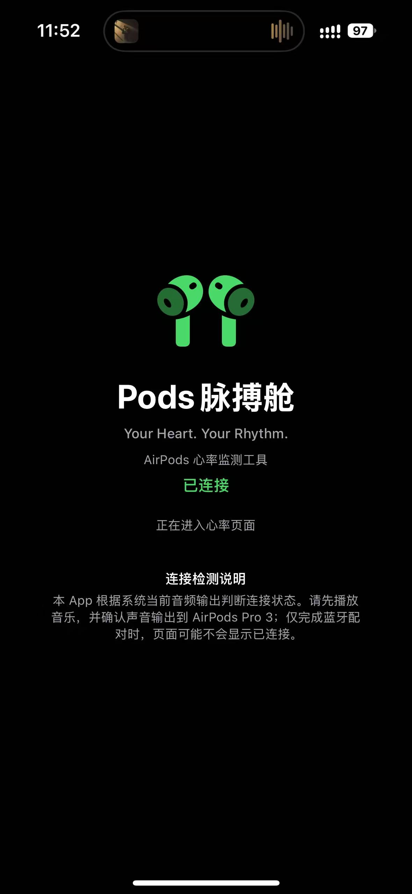
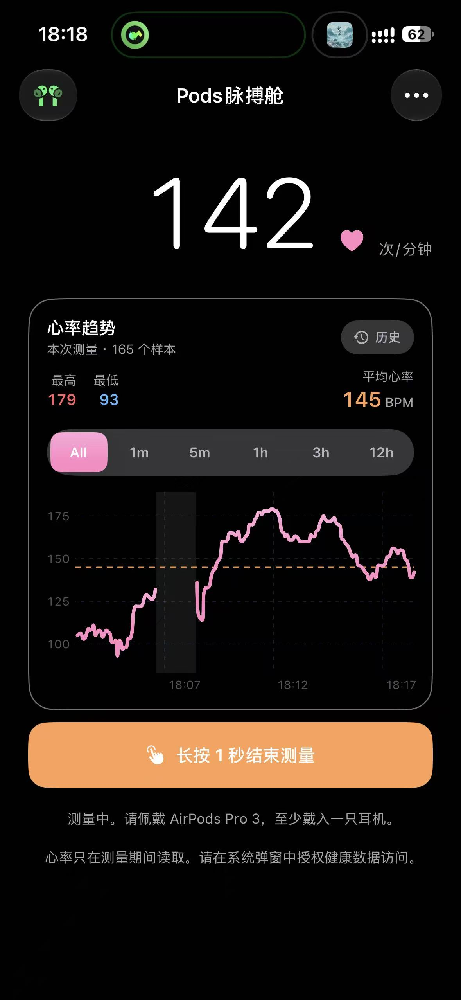
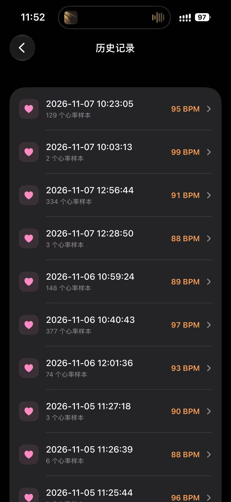
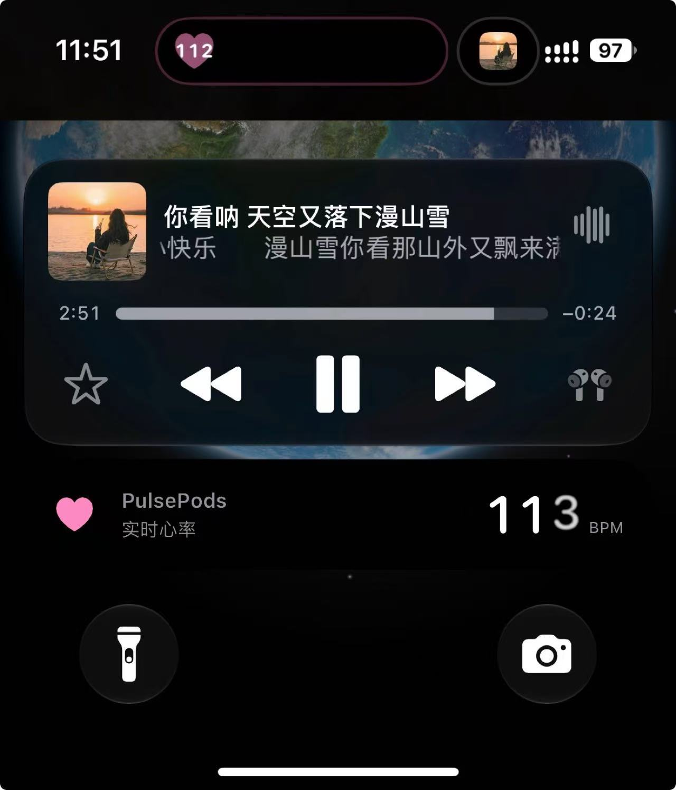
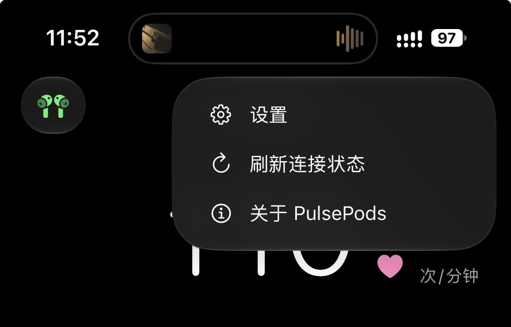

# PulsePods

[简体中文](README.md) | [English](README.en.md)

PulsePods is an iOS app for monitoring heart rate during workouts with AirPods Pro 3. It shows the current AirPods audio connection state, displays live heart-rate readings, charts the readings over time, and saves workout records to Apple Health.

## Features

- Detects whether AirPods Pro are the current audio output route.
- Reads live heart-rate samples through a HealthKit workout session.
- Displays heart-rate history and a live chart during measurement.
- Saves the workout record to Apple Health when measurement ends.

## Screenshots

### Startup and connection status

The app shows AirPods connection status at launch and proceeds to measurement after connection.

### Live heart-rate measurement

The measurement screen displays the current heart rate and live chart.

### Heart-rate history

Review saved measurement records in the history table.

### Dynamic Island and Lock Screen

During measurement, the app provides activity status on the Dynamic Island and Lock Screen.

### Menu

## Requirements

- iPhone running iOS 18.5 or later to install and launch the app.
- iOS 26 or later and AirPods Pro 3 for heart-rate measurement.
- HealthKit access granted by the user.
- Xcode and an Apple Developer team with HealthKit capability to build and sign the app.

On iOS versions earlier than 26, the app can launch, but heart-rate measurement is unavailable.

## Build and run

1. Open `PulsePods.xcodeproj` in Xcode.
2. Select the `PulsePods` scheme and an iPhone device or simulator.
3. Configure the signing team under **Signing & Capabilities**.
4. Build and run the app.

Real AirPods Pro 3 heart-rate readings require a supported physical iPhone, compatible AirPods, iOS 26 or later, and HealthKit authorization. The simulator cannot provide real AirPods heart-rate data.

## Privacy

Heart-rate data is accessed through HealthKit for the app's measurement and workout-record features. Review the in-app permission prompts and privacy policy before distribution. Complete the App Store privacy disclosures according to the app's actual data handling.
