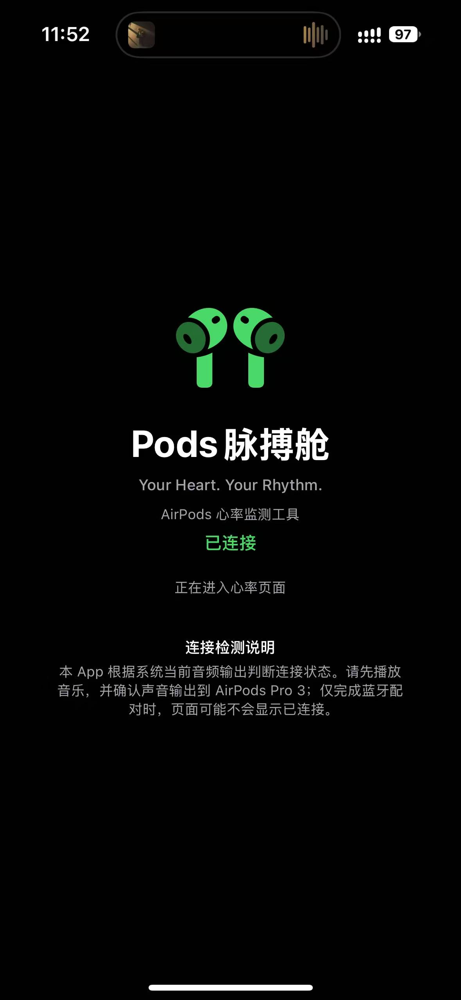
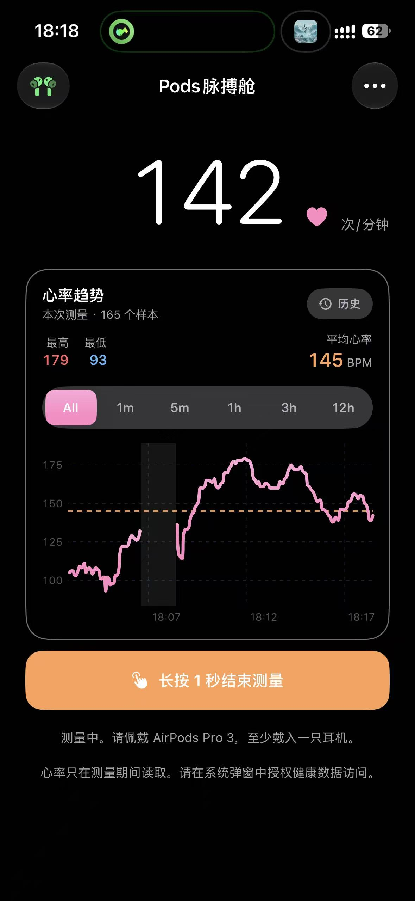
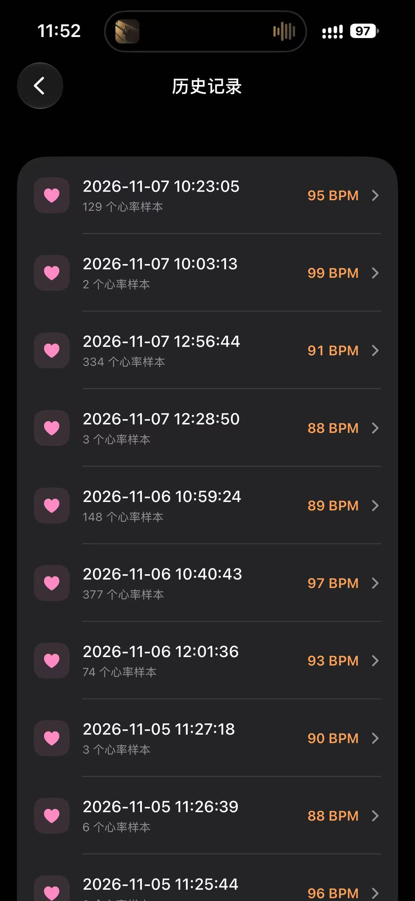
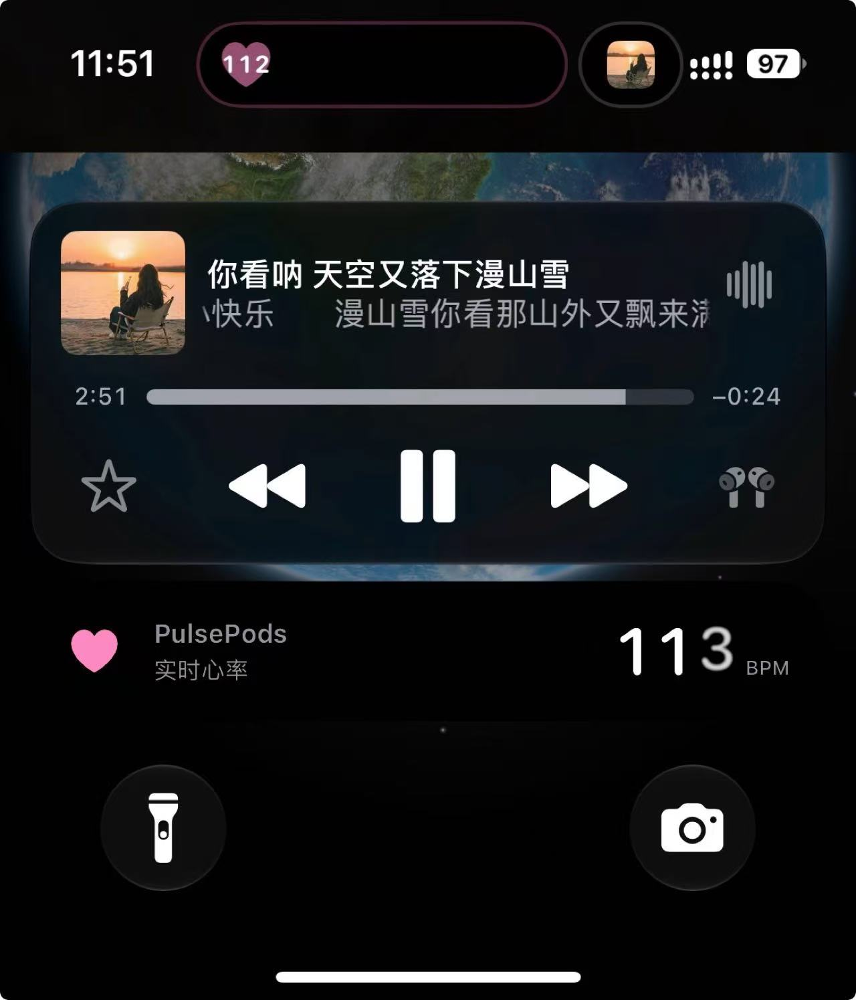
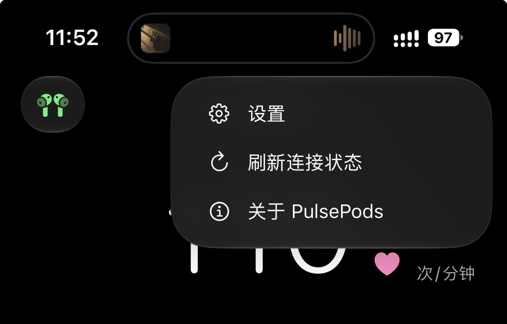

# PulsePods

[简体中文](README.md) | [English](README.en.md)

PulsePods 是一款面向 AirPods Pro 3 用户的 iOS 心率监测 App。它可以显示 AirPods 当前的音频连接状态，在运动测量期间显示实时心率和变化曲线，并在结束测量时将运动记录保存到 Apple 健康。

## 功能

- 检测 AirPods Pro 是否为当前音频输出设备。
- 通过 HealthKit 运动会话读取实时心率样本。
- 在测量期间显示心率历史和实时曲线。
- 结束测量时将运动记录保存到 Apple 健康。

## 界面预览

### 初始化与连接状态

首次打开 App 时会显示 AirPods 连接状态；连接后可继续进入测量。

### 实时心率测量

测量主界面展示当前心率和实时变化曲线。

### 心率历史记录

历史页面以表格形式查看已保存的心率测量记录。

### 灵动岛与锁屏状态

测量期间可在灵动岛和锁屏界面查看活动提示。

### 菜单界面

## 系统要求

- iPhone 需运行 iOS 18.5 或更高版本才能安装并启动 App。
- 心率测量需要 iOS 26 或更高版本及 AirPods Pro 3。
- 用户需授权 App 访问 HealthKit。
- 构建和签名需要 Xcode，以及已启用 HealthKit 功能的 Apple Developer 团队。

低于 iOS 26 的系统可以启动 App，但无法使用心率测量功能。

## 构建和运行

1. 使用 Xcode 打开 `PulsePods.xcodeproj`。
2. 选择 `PulsePods` Scheme 和 iPhone 设备或模拟器。
3. 在 **Signing & Capabilities** 中配置签名团队。
4. 构建并运行 App。

获取真实的 AirPods Pro 3 心率数据，需要兼容的实体 iPhone、AirPods Pro 3、iOS 26 或更高版本，以及 HealthKit 授权。模拟器无法提供真实的 AirPods 心率数据。

## 隐私

App 通过 HealthKit 访问心率数据，用于测量和运动记录功能。正式发布前，请检查 App 内的权限说明和隐私政策，并根据 App 实际的数据处理方式填写 App Store 隐私披露。
